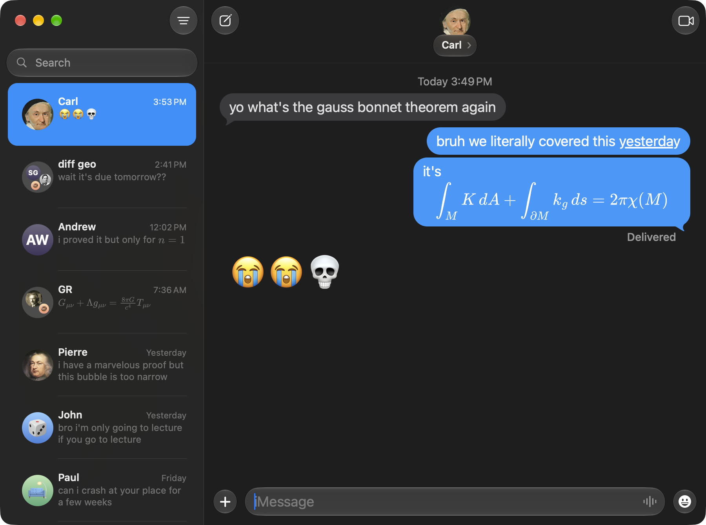

# tex messages

imessage for macos, but with latex in your bubbles

yes, these are real imessages, sent and received through your actual account



## install

```
brew install deancureton/tap/tex-messages
```

needs macos 26+. it reads your messages database, so grant full disk access when it asks

## usage

put latex between delimiters in any message:

- inline: `$...$` or `\(...\)`
- display: `$$...$$` or `\[...\]`

prices like $5 are left alone
